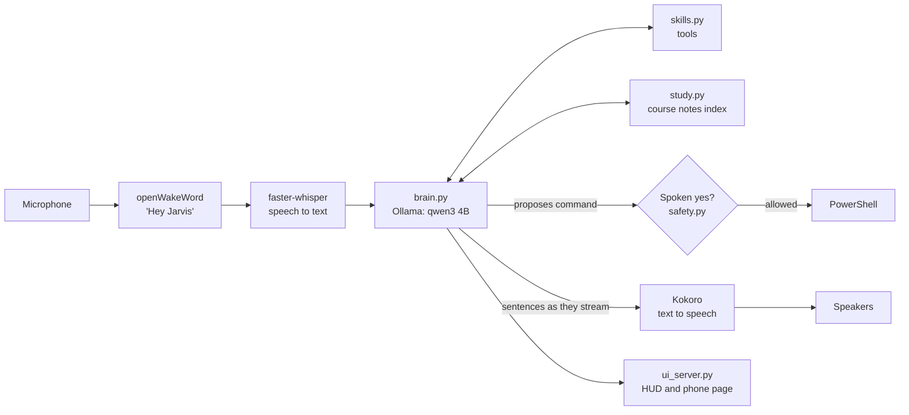

# Jarvis: an offline voice assistant for Windows

Say "Hey Jarvis", ask a question, and hear the answer, with every step running on your own laptop. There are no cloud speech services and no API keys, and nothing you say leaves the machine.

Jarvis listens for its wake word, turns speech into text with Whisper, answers with a local language model served by [Ollama](https://ollama.com), and speaks the reply in a British voice with Kokoro. It can control the laptop, read your class schedule and coursework deadlines, search the web, take lecture notes, and answer questions from your own course files.


## What it can do

- **Hands-free conversation.** It starts on "Hey Jarvis" and keeps listening for follow-ups. You can interrupt it mid-sentence by saying the wake word again.
- **Fast replies.** The reply is spoken sentence by sentence while the model is still writing the rest, so Jarvis starts talking before the whole answer is ready.
- **Tool use.** The model picks from about 15 skills: open apps and folders, volume and media keys, timers, system status, file search, weather, web search, Canvas deadlines, the class timetable, and the university calendar.
- **Safe laptop commands.** For anything the skills don't cover, the model can propose a single PowerShell command. Jarvis reads it out and runs it only after a spoken "yes". Even with a yes, a [safety filter](safety.py) refuses anything that deletes files, alters disks, edits the registry, downloads code, or touches Jarvis's own files.
- **Answers from your course material.** PDFs, Word files and slides in your school folder are split into passages and indexed with embeddings (`nomic-embed-text`). Jarvis answers from the closest matches and says which file the answer came from. Scanned or handwritten pages are read by a local vision model.
- **Lecture notes.** "Take notes" transcribes a class in 30-second pieces. When it ends, Jarvis opens the transcript and a summary.
- **Timetable from a calendar feed.** Jarvis reads iCalendar repeat rules itself (weekly, every other week, end dates, counts and cancellations) and checks the university calendar for breaks.
- **It learns over time.** Jarvis keeps a journal of conversations. While idle, it extracts lasting facts, but only ones backed by a direct quote. It also logs what it couldn't do, and you can teach it words it keeps mishearing.
- **It can ask for repairs.** If you report a fault, Jarvis can pass the job to Claude Code, with your confirmation. Your code is backed up first, and if the result doesn't compile, the backup is put back.
- **HUD and phone page.** A small window shows its state and live speech levels. A passcode-protected phone page, reached over Tailscale, lets you talk to it from your phone.

## How it works



| File | Role |
|---|---|
| `listen.py` | Main loop: microphone, wake word, recording, transcription, voice output, interruptions |
| `brain.py` | Prompt, conversation history, tool calling, streamed replies, confirmations |
| `skills.py` | The tools: apps, media, timers, weather, search, Canvas and calendar feeds |
| `safety.py` | Commands that are refused outright |
| `study.py` | Indexes course files and finds passages by meaning |
| `learning.py` | Journal, fact extraction, vocabulary, feature suggestions |
| `settings.py` | Settings Jarvis can change by voice, within fixed limits |
| `ui_server.py` | Local web server for the HUD and the phone page |
| `owner.py` | Fills in the user's name from `config.json`, so the code itself names no one |

## Setup

These steps are for Windows 10 or 11 with Python 3.12.

1. Install [Ollama](https://ollama.com), then pull the models:
   ```
   ollama pull qwen3:4b-instruct
   ollama pull nomic-embed-text
   ```
2. Create a virtual environment and install the requirements:
   ```
   py -3.12 -m venv .venv
   .venv\Scripts\pip install -r requirements.txt
   ```
3. Download `kokoro-v1.0.onnx` and `voices-v1.0.bin` from the [kokoro-onnx releases](https://github.com/thewh1teagle/kokoro-onnx/releases) into a `models` folder.
4. Copy `config.example.json` to `config.json` and fill it in. The Canvas and calendar links are optional.
5. Run `Jarvis.bat` and say "Hey Jarvis".

`config.json`, the journal, and everything Jarvis learns are listed in `.gitignore` and stay on your machine.

## Tests

The pure logic is covered by unit tests: the command safety filter, settings limits, calendar repeat rules, request matching, and text cleanup for speech. They run on every push.

```
pip install -r requirements-dev.txt
pytest
```

## Notes

Built by Luke Robinson, a Computer Engineering student at UNC Charlotte, with AI assistance from Claude Code.
